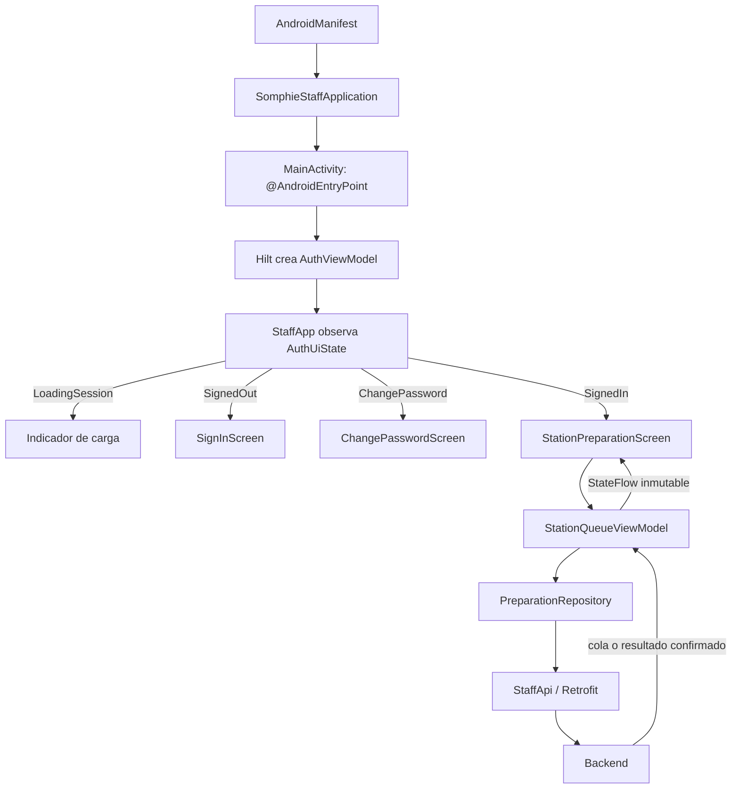

# Guía de arquitectura y estudio de Android

Esta guía describe la app de personal tal como está implementada hoy. Es una única aplicación Kotlin/Compose en `:app`, organizada por responsabilidad y funcionalidad; no usa todavía Navigation Compose ni módulos Gradle separados. La app muestra el estado del backend y envía acciones autorizadas, pero no reemplaza sus validaciones.

## 1. Mapa del módulo

```text
android/
├── build.gradle.kts                 versiones de plugins
├── settings.gradle.kts              repositorios y módulo :app
├── gradle.properties                opciones comunes de Gradle/AGP
└── app/
    ├── build.gradle.kts             Android, variantes, dependencias y pruebas
    └── src/
        ├── main/
        │   ├── AndroidManifest.xml  permisos y actividad de inicio
        │   ├── kotlin/com/somphie/staff/
        │   │   ├── MainActivity.kt
        │   │   ├── SomphieStaffApplication.kt
        │   │   ├── app/             composición de estados de autenticación
        │   │   ├── core/design/     tema Material 3
        │   │   ├── core/network/    DTO, Retrofit, OkHttp y errores HTTP
        │   │   ├── core/storage/    tokens cifrados
        │   │   └── feature/
        │   │       ├── auth/        autenticación y cambio obligatorio de clave
        │   │       └── stations/    selección de estación y cola de preparación
        │   └── res/values/          textos es-AR y tema XML
        ├── test/                    pruebas unitarias y HTTP con MockWebServer
        └── androidTest/             pruebas Compose instrumentadas en Android
```

La división es intencionalmente sencilla: `feature` contiene los flujos funcionales; `core` comparte infraestructura transversal. No hay una capa `domain` artificial: las reglas de negocio permanecen en el backend y la UI solo deriva qué controles mostrar de permisos, estado y respuestas del servidor.

## 2. Recorrido de la aplicación



`MainActivity` instala el tema y entrega a `StaffApp` el `AuthViewModel` de Hilt. `StaffApp` observa el `StateFlow<AuthUiState>` y elige una pantalla completa según el estado de sesión. La pantalla de preparación obtiene su propio `StationQueueViewModel`; no se comparte el estado de autenticación con la cola salvo el perfil recibido (permisos y estaciones).

En Compose, los cambios en el `StateFlow` provocan una nueva composición. La UI no modifica directamente el pedido: llama una función del ViewModel, que coordina la operación y publica un nuevo estado. La lista usa `itemId` como clave estable para que Compose pueda conservar la identidad de cada tarjeta al actualizar o paginar.

## 3. Estado, ciclo de vida y concurrencia

### Autenticación

`AuthUiState` hace explícitas las alternativas que puede representar `StaffApp`:

- `LoadingSession`: está leyendo/restaurando los tokens y consultando `/me`.
- `SignedOut`: muestra el login y su error recuperable si corresponde.
- `ChangePassword`: el servidor exige actualizar la contraseña antes de operar.
- `SignedIn`: habilita la pantalla operativa con el perfil devuelto por `/me`.
- `RestoreError`: la sesión almacenada no se pudo validar; permite reintentar o volver al login.

`AuthViewModel` inicia la restauración en `viewModelScope`. Los intentos HTTP y las lecturas de almacenamiento son suspendibles, por lo que no bloquean la composición de la pantalla. Los errores de API, red, serialización y almacenamiento tienen caminos visibles distintos; no se convierten en una sesión exitosa por defecto.

### Cola de estación

`StationQueueUiState` guarda la lista confirmada por servidor, la estación/filtro, los estados de carga, errores y las acciones ambiguas que pueden reintentarse. Al cambiar estación o filtro se descartan los datos de la selección anterior antes de pedir la siguiente página. Un contador de generación invalida respuestas tardías que pertenecen a una selección anterior.

La lectura inicial muestra carga; una cola vacía muestra un mensaje específico; un error preserva el último snapshot confirmado para no borrar información operativa. La actualización automática se ejecuta cada cinco segundos solo mientras la pantalla está `RESUMED`. El ViewModel evita lecturas solapadas y puede solicitar una lectura adicional si una actualización coincide con una acción. La paginación usa el cursor que devuelve el backend; refrescar comienza nuevamente desde la primera página porque el contrato describe consistencia eventual.

Las acciones no actualizan optimistamente el estado del producto. Al recibir éxito, la pantalla vuelve a consultar la cola. Un `409` también provoca una lectura nueva, porque otra operación pudo haber cambiado el ítem. Una respuesta de red ambigua conserva en memoria la acción, su motivo y la misma `Idempotency-Key`; el reintento repite esa operación y no crea una nueva clave. Esa operación pendiente vive en memoria, no en almacenamiento persistente: si Android termina el proceso, la app vuelve a leer la fuente de verdad del backend.

## 4. Comunicación HTTP, permisos y transiciones

`StaffApi` declara las rutas de autenticación, perfil, estaciones, cola y acciones de ítem. `StaffNetworkModule` construye Retrofit/OkHttp y aporta los objetos compartidos mediante Hilt. El interceptor agrega el access token guardado; ante un `401`, el `Authenticator` sincroniza la renovación del refresh token rotativo y limita el intento para evitar bucles. Si el servidor rechaza definitivamente la renovación, se limpian los tokens locales; si falla la red, la pantalla permite recuperarse sin fingir que el usuario quedó autenticado.

`apiCall` transforma un Problem+JSON conocido en `ApiFailure` con su código HTTP y código de dominio. Si la respuesta no puede decodificarse, el cliente conserva una categoría genérica en vez de asumir éxito. La app tolera estados futuros en DTO/UI: una transición desconocida no recibe acciones habilitadas.

La vista se basa en `permissions` y `stations` entregados por `/me` y `/staff/stations`, no en el nombre del rol. `availableActions` es una protección de UX: por ejemplo, `QUEUED` permite iniciar o marcar listo si existe `item.prepare`; `READY` puede permitir entregar si existe `item.deliver`. No es una frontera de seguridad: cada endpoint vuelve a comprobar permiso, estación, sesión y transición. Las reglas canónicas están en `docs/02-dominio/estados-y-transiciones.md` y el contrato en `docs/04-api/openapi.yaml`.

El flujo cliente crea pedidos `PENDING_REVIEW`; la cola de preparación solo contiene ítems activos que ya están `QUEUED`, `IN_PREPARATION` o `READY`. Android todavía no implementa la bandeja entrante WP-AND-51 para aceptar/rechazar pedidos. En la prueba física de este bloque, el pedido QR fue aceptado por el endpoint staff aprobado antes de aparecer en la estación; no se simuló la aceptación en la app.

## 5. Autenticación y almacenamiento

`AuthRepository` adapta las rutas `/auth/login`, `/auth/change-password`, `/me` y `/auth/logout`. Las pantallas no guardan ni transmiten tokens directamente. `EncryptedTokenStore` serializa el par de tokens y cifra el contenido con AES-GCM; la clave AES se genera y permanece en Android Keystore. El texto cifrado se conserva en Preferences DataStore. No se almacena la contraseña.

El perfil de `/me` incluye `mustChangePassword`, `permissions` y `stations`; la contraseña temporal solo conduce a la pantalla obligatoria cuando el backend devuelve esa condición. Las cuentas de demostración existentes consultadas en el entorno local tenían `mustChangePassword=false`. El seeder documentado no ofrece una opción para activar el cambio requerido; alterar esa columna directamente no es un flujo permitido, por lo que el cambio obligatorio no se probó en el teléfono.

Al cerrar sesión se intenta revocar el refresh token en el backend y se eliminan los tokens locales incluso si la red falla. Una instalación con credenciales cifradas ilegibles informa error y ofrece volver al login explícitamente.

## 6. Entornos y conectividad

`app/build.gradle.kts` configura `BuildConfig.API_BASE_URL`:

- `debug` usa por defecto `http://10.0.2.2:8080/api/v1/`, dirección del host desde el emulador.
- `release` exige HTTPS y no permite tráfico HTTP en claro.
- `-PsomphieApiBaseUrl=...` cambia la URL para una compilación local sin modificar archivos del repositorio.

En un teléfono físico conectado por USB, `127.0.0.1` del dispositivo no es el host por sí mismo. `adb reverse tcp:8080 tcp:8080` crea el túnel y permite usar `http://127.0.0.1:8080/api/v1/` en un APK de depuración. La alternativa por Wi-Fi necesita IP LAN, firewall y equipo en la misma red; no hay que cambiar la URL de producción para probar localmente.

## 7. Pruebas y qué validan

| Grupo | Tipo | Qué comprueba | Qué no demuestra |
|---|---|---|---|
| `StationQueueViewModelTest` | Unitarias con fake y `kotlinx-coroutines-test` | Estados de carga/contenido/error, snapshot preservado, permisos, transiciones visibles, conflictos y reintento con la misma clave | Conectividad ni persistencia real del backend |
| `PreparationRepositoryContractTest` | HTTP local simulado con MockWebServer | Rutas, query, cuerpo de cancelación y `Idempotency-Key` | PostgreSQL o autorización real |
| `AppStartupTest` | Compose instrumentada en teléfono/emulador | Integración Activity/Hilt/Compose, presentación de error de red bajo la URL de prueba y estilo de barras del sistema | Inicio de sesión contra el backend salvo que se haga una prueba física separada |
| Prueba manual física registrada abajo | App instalada contra backend y PostgreSQL locales | Login/restauración real, lectura de cola y persistencia de dos transiciones | Cambio obligatorio de contraseña; acciones para una cola llena más allá del producto preparado |

Desde la raíz de Windows:

```powershell
.\android\gradlew.bat -p android :app:compileDebugKotlin --no-daemon --max-workers=1
.\android\gradlew.bat -p android testDebugUnitTest --no-daemon --max-workers=1
.\android\gradlew.bat -p android assembleDebug --no-daemon --max-workers=1
.\android\gradlew.bat -p android lintDebug --no-daemon --max-workers=1
.\android\gradlew.bat -p android connectedDebugAndroidTest -PsomphieApiBaseUrl=http://127.0.0.1:8080/api/v1/ --no-daemon --max-workers=1
```

La prueba instrumentada de error de conexión solo corre cuando `API_BASE_URL` comienza con `http://127.0.0.1:1/`; con el backend local en el puerto 8080 se omite intencionalmente. Para ejecutarla aislada se compila/instala el APK con esa URL de prueba, no se desconecta ni se reconfigura el servidor de producción.

## 8. Validación física y datos de prueba actuales

El 18-10-2026, conectado por USB al Moto G31, se creó una sesión en `TBL-001` mediante `POST /public/tables/{tableCode}/sessions`; se creó un pedido real con Flat white y su opción requerida “Chico” mediante `POST /sessions/current/orders`, incluyendo `acknowledgedTotalMinor` e `Idempotency-Key`. El owner demo aceptó el pedido por la API real, pues la app no contiene la bandeja de entrantes. La pantalla autorizada para la estación BAR mostró el ítem `#001`.

Desde los controles Android se ejecutó `QUEUED -> IN_PREPARATION -> READY`. Después de cada acción, la cola se actualizó desde el backend. Una consulta de solo lectura a PostgreSQL confirmó `order.status=READY`, `order_item.status=READY` y estación `BAR`. La sesión y el pedido de prueba se dejaron abiertos deliberadamente para que se puedan inspeccionar en el teléfono; no se borró ni se alteró ninguna fila directamente. El backend y PostgreSQL deben seguir iniciados, con el túnel USB activo, para continuar probando.

Para retirar **solo este fixture propio** luego de terminar la prueba, respetá el flujo de negocio: mientras el ítem todavía no esté `DELIVERED`, el personal autorizado puede cancelarlo con motivo usando `POST /staff/order-items/{itemId}/cancel` y una clave de idempotencia nueva. La cancelación conserva el pedido en historial, elimina el cargo correspondiente y devuelve el ítem a un estado terminal. Si la sesión queda sin pedidos pendientes/ítems activos y saldo cero, se puede cerrar normalmente con `POST /staff/sessions/{sessionId}/close` (sin cuerpo ni clave idempotente). No usar SQL DELETE/TRUNCATE, `docker compose down -v` ni cierre forzado para limpiar. Si el ítem se entrega, el saldo debe liquidarse por el flujo aprobado antes del cierre; no se debe inventar una limpieza.

## 9. Limitaciones y migración

- No hay bandeja entrante, navegación entre features, administración de mesas, pagos, SSE ni sincronización offline.
- El polling REST de cinco segundos es la estrategia documentada para esta fase; SSE depende de WP-BE-60 y de sus criterios operativos aprobados.
- Los controles de Android no autorizan: el servidor sigue siendo la frontera. Tampoco se guarda offline una acción ambigua entre reinicios del proceso.
- `StaffApi` usa DTO de transporte en `core/network`; no hay modelos de dominio o mappers porque hoy no hay una regla local que los justifique.
- Para crecer, conviene extraer un `domain` solo cuando haya lógica compartida que pueda probarse sin Android, introducir Navigation Compose al aparecer más destinos, y agregar una fuente persistente de acciones solo si se define una política segura de reintento. Cada cambio podría alterar la navegación, recuperación, privacidad o la semántica de idempotencia; necesita pruebas de migración y no debe cambiar contratos por conveniencia de UI.

## 10. Orden de lectura archivo por archivo

Seguí el recorrido de menor a mayor complejidad. Las rutas son relativas a `android/`.

| Orden | Archivo | Qué aprender | Leer antes |
|---:|---|---|---|
| 1 | `app/src/main/res/values/strings.xml` | Textos es-AR centralizados y códigos visibles | — |
| 2 | `app/src/main/kotlin/com/somphie/staff/core/design/StaffTheme.kt` | Paleta Material 3 y colores semánticos | 1 |
| 3 | `app/src/main/AndroidManifest.xml` | Permiso de red, Application y Activity exportada de launcher | — |
| 4 | `app/src/main/kotlin/com/somphie/staff/SomphieStaffApplication.kt` | Punto de arranque del grafo Hilt | 3 |
| 5 | `app/src/main/kotlin/com/somphie/staff/MainActivity.kt` | `@AndroidEntryPoint`, edge-to-edge, barras del sistema y composición raíz | 2–4 |
| 6 | `app/src/main/kotlin/com/somphie/staff/core/network/ApiModels.kt` | DTO serializables que reflejan respuestas del contrato | `docs/04-api/openapi.yaml` |
| 7 | `app/src/main/kotlin/com/somphie/staff/core/network/StaffApi.kt` | Correspondencia de cada función Retrofit con una ruta HTTP | 6 |
| 8 | `app/src/main/kotlin/com/somphie/staff/core/network/ApiFailure.kt` | Conversión de Problem+JSON y errores HTTP | 6–7 |
| 9 | `app/src/main/kotlin/com/somphie/staff/core/storage/EncryptedTokenStore.kt` | DataStore, cifrado AES-GCM y Keystore | 6 |
| 10 | `app/src/main/kotlin/com/somphie/staff/core/network/StaffNetworkModule.kt` | Hilt, Retrofit, Authorization y renovación coordinada | 7–9 |
| 11 | `app/src/main/kotlin/com/somphie/staff/feature/auth/data/AuthRepository.kt` | Frontera de datos para login, perfil, cambio y cierre | 7–10 |
| 12 | `app/src/main/kotlin/com/somphie/staff/feature/auth/ui/AuthScreens.kt` | Formularios Compose, textos accesibles y estados de autenticación | 1, 11 |
| 13 | `app/src/main/kotlin/com/somphie/staff/feature/auth/ui/AuthViewModel.kt` | Máquina de estados, corrutinas y recuperación de sesión | 9, 11–12 |
| 14 | `app/src/main/kotlin/com/somphie/staff/app/StaffApp.kt` | Selección de pantalla según `AuthUiState` | 5, 12–13 |
| 15 | `app/src/main/kotlin/com/somphie/staff/feature/stations/data/PreparationRepository.kt` | Cola, rutas de acción y conservación de clave idempotente | 7–8 |
| 16 | `app/src/main/kotlin/com/somphie/staff/feature/stations/ui/StationQueueViewModel.kt` | Estado inmutable, paginación, concurrencia, permisos y transiciones visibles | 6, 15 |
| 17 | `app/src/main/kotlin/com/somphie/staff/feature/stations/ui/StationPreparationScreen.kt` | Ciclo de vida, polling, estados de UI, tarjetas y acciones | 1–2, 14–16 |
| 18 | `app/src/test/kotlin/com/somphie/staff/TestDispatcherRule.kt` | Control determinista del dispatcher de corrutinas | Kotlin Coroutines Test |
| 19 | `app/src/test/kotlin/com/somphie/staff/feature/stations/ui/StationQueueViewModelTest.kt` | Fakes, secuencias de estado y reintentos comprobables | 16, 18 |
| 20 | `app/src/test/kotlin/com/somphie/staff/feature/stations/data/PreparationRepositoryContractTest.kt` | Verificación de HTTP con MockWebServer | 7, 15 |
| 21 | `app/src/androidTest/kotlin/com/somphie/staff/AppStartupTest.kt` | Pruebas Compose que requieren Activity/Android reales | 5, 12–14 |
| 22 | `app/build.gradle.kts` | SDK, dependencias, URL por variante y configuración de tests | archivos anteriores |
| 23 | `build.gradle.kts`, `settings.gradle.kts`, `gradle.properties` | Plugins, repositorios, módulo y opciones globales del build | 22 |

Al evaluar una migración, cambiá una sola frontera por vez: primero presentación, luego estado, después acceso a datos. Conservá los nombres/semántica de la API; una reorganización de paquetes no autoriza a cambiar permisos, transiciones, identificadores ni manejo de reintentos.
